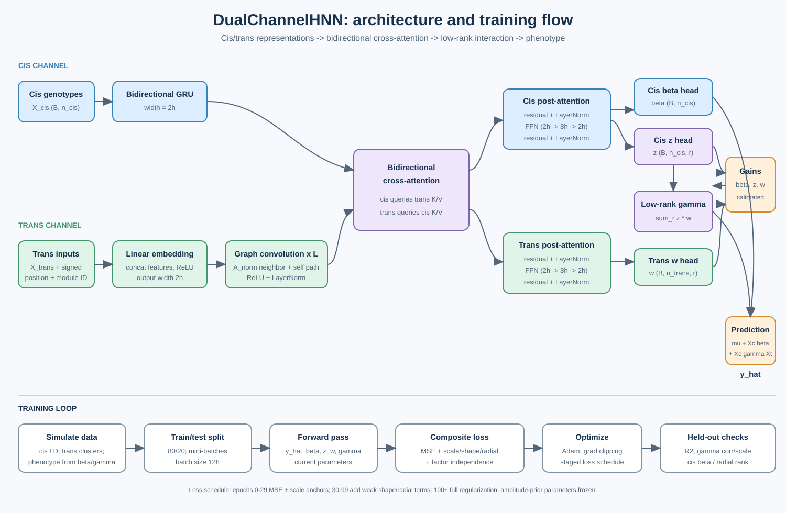

# DualChannelHNN

A PyTorch implementation of a dual-channel cis/trans eQTL model. The model estimates cis additive effects (`beta`) and low-rank cis/trans interaction effects (`gamma`) from preprocessed genotype arrays. It combines a bidirectional GRU for cis SNPs, a graph neural network for trans SNPs, bidirectional cross-attention, post-normalized residual feed-forward blocks, and a low-rank interaction decoder.

## Intended data-processing context

In the intended analysis workflow, TensorQTL is used upstream to obtain and align genotype and phenotype arrays. Population structure and PEER-derived phenotype covariance are handled before the HNN: the PEER covariance component is projected out in the spatial domain, and the model is supplied the remaining orthogonal-complement/effect components. Consequently, DualChannelHNN is intended to model only the cis- and trans-SNP effect components; it is not itself a TensorQTL association engine, population-stratification correction, or PEER-projection implementation.

The included synthetic harness does not execute TensorQTL or PEER preprocessing; it generates synthetic genotypes and phenotypes to exercise the architecture.

## Prior structure and architecture

- **Cis channel:** a bidirectional (forward/reverse) GRU encodes ordered cis SNP inputs. Its recurrent representation is intended to encode prior information and capture possible LD structure among cis SNPs.
- **Trans channel:** trans genotypes are combined with signed genomic positions and module labels, embedded, and propagated over a fixed normalized adjacency with graph convolution. In the intended applied workflow, the trans graph prior is derived from RNA-seq co-expression/network analysis with pyWGCNA and organized to reflect the tree-like trans-SNP topology around the cis center. The model accepts this adjacency as an input.
- **Synthetic-demo distinction:** the included simulation harness constructs a radial adjacency from trans-SNP distances; it does not call pyWGCNA. Replace the supplied adjacency with the pyWGCNA-derived graph for the intended applied workflow.
- **Cross-channel fusion:** each channel attends to the other, then applies residual LayerNorm and a feed-forward block with another residual LayerNorm.
- **Effect decoding:** separate heads estimate cis `beta`, cis factors `z`, and trans factors `w`; `gamma` is formed as `z @ w.T` per sample and used in phenotype prediction.



The diagram describes the representation flow, interaction/prediction equations, and the staged training procedure. See [`dual_channel_hnn.py`](dual_channel_hnn.py) for the reusable PyTorch model.

## Model usage

```python
import torch
from dual_channel_hnn import DualChannelHNN

# x_cis: (batch, n_cis), x_trans: (batch, n_trans)
# A_norm: (n_trans, n_trans); positions and module_ids: (n_trans,)
model = DualChannelHNN(
    hidden_dim=32,
    rank=2,
    adjacency=A_norm,
    trans_positions=trans_positions,
    module_ids=module_ids,
    target_gamma_std=target_gamma_std,
    beta_initial_std=beta_initial_std,
    attention_heads=4,
    n_gnn_layers=2,
)
model.calibrate_factor_gains(x_cis[:256], x_trans[:256])
y_hat, beta, z, w, gamma = model(x_cis, x_trans)
```

`gamma` has shape `(batch, n_cis, n_trans)`. For each sample it is the sum of rank-one factor products. Prediction is `mu + sum(beta * X_cis) + sum(gamma * X_cis * X_trans)`.

## Synthetic training results

The following results are from the revised post-normalized model, trained for 300 epochs on 1,200 synthetic samples per case with an 80/20 train/test split. Cases vary cis/trans SNP counts, the number of cis LD blocks, or the number and distance/pattern of trans clusters. The numeric data are in [`model_sweep_summary.csv`](model_sweep_summary.csv); [`gamma_recovery_summary.svg`](gamma_recovery_summary.svg) visualizes gamma correlation and scale recovery across cases.

| Case | Cis / trans SNPs | Gamma correlation | Gamma NRMSE | Gamma scale ratio | Radial Spearman | Held-out R² | Cis beta correlation |
|---|---:|---:|---:|---:|---:|---:|---:|
| Baseline | 15 / 50 | 0.9774 | 0.2126 | 0.9766 | -0.9834 | 0.9877 | 0.9824 |
| More cis LD blocks | 30 / 60 | 0.9879 | 0.1598 | 0.9580 | -0.9837 | 0.9849 | -0.9676 |
| More trans clusters | 20 / 80 | 0.9760 | 0.2184 | 0.9602 | -0.9999 | 0.9923 | 0.8391 |
| Asymmetric distance bands | 18 / 72 | 0.9894 | 0.1472 | 0.9841 | -1.0000 | 0.9934 | 0.7931 |

The gamma recovery metrics are strong in these deterministic synthetic tests. Interpret cis beta recovery cautiously: in the 30-cis-SNP case its correlation is negative despite strong held-out prediction and gamma metrics, indicating that prediction quality alone does not guarantee recovery of individual additive effects when predictors are correlated. Results are demonstrations on synthetic data, not independent empirical validation.

## Training design

The simulation harness uses mini-batch Adam optimization and staged regularization. Early epochs emphasize MSE and output-scale anchors; shape, radial amplitude/ranking, and factor-independence terms are added later. Held-out evaluation includes phenotype R², gamma correlation/scale, radial rank correlation, and cis-effect recovery.

## Requirements and data

- Python 3.10+
- PyTorch
- NumPy and Matplotlib for the synthetic simulation/plotting harness

This repository contains synthetic model code and summary metrics only; it includes no real genotype or RNA-seq data.
---

# Latent-space MD model (`latent_md*.py`)

A second, **independent** PyTorch prototype (it does not use `DualChannelHNN`). Input: an ensemble of MD trajectories of one complex (coordinates per time step). It learns (i) a latent space whose elements decode back to structures, (ii) interpretable labels on that space (energy, contact state, ...), and (iii) a stochastic transition rule on the latent space that can be run directly, i.e. evolve the system in latent space and decode the result.

It has been validated **only on a synthetic 8-atom two-domain complex with analytic forces** (`latent_md_toy.py`); no real MD data were used. The real-data runner (`latent_md_real.py`) is tested on array input and on a PDB+DCD written from that toy system, so treat results on real data as unverified until you have checked them (see [Limitations](#limitations)).

| File | Purpose |
|---|---|
| [`latent_md.py`](latent_md.py) | the model, the trainer and the geometry helpers (Kabsch, RMSD, classical MDS) |
| [`latent_md_real.py`](latent_md_real.py) | command-line runner for real trajectories (`.npy`/`.npz` or anything MDAnalysis reads) |
| [`latent_md_toy.py`](latent_md_toy.py) | synthetic MD ground truth (three contact conformations, Langevin dynamics, random lab frames) |
| [`latent_md_demo.py`](latent_md_demo.py) | trains and assesses the model on the toy system, writes [`latent_md_summary.csv`](latent_md_summary.csv) |
| [`test_latent_md.py`](test_latent_md.py) | 24 fast tests (`pytest -q`, about 10 s) |
| [`requirements-latent-md.txt`](requirements-latent-md.txt) | dependencies (CPU PyTorch is enough) |

## Layout

```
 snapshot x_t (N atoms, any lab frame)
        │  pair distances (invariant to rotation/translation), standardised
        ▼
   encoder f  ──────────────►  z_t ∈ R^d  ──┬─► decoder g ──► g(z_t) ≈ x_t   structure of every latent element
                                            ├─► label head h(z_t) = E[label | z_t]    energy, contact state, ...
                                            ├─► landscape F(z_t)  (k_B T)             what drives the dynamics
                                            └─► policy π(z' | z_t) = N(z_t + b(z_t), 2 M(z_t))
                                                       │  next latent point after one lag
                                                       ▼
                         rollout z_t → z_{t+lag} → z_{t+2·lag} → ...   decode / label at any step
```

- **Encoder `f`** (`StructureEncoder`): pair distances → standardise → MLP → `z`. Exactly invariant to rotation and translation, so snapshots from different trajectories and ensembles share one latent space without alignment.
- **Decoder `g`** (`StructureDecoder`): `center(reference + length_scale · MLP(z))`. Deterministic and defined for **every** `z` (not only for encoded data), so the latent→structure map is an honest function. It returns the conditional-mean structure up to a rigid motion, so fast thermal noise is averaged out.
- **Policy `π`** (`LatentLangevinPolicy`): state = current latent point; "action" = the probability distribution of the next latent point after one lag (a diagonal Gaussian). The mean is the Euler–Maruyama step of overdamped Langevin dynamics, `b = −M ∇F + ∇·M`, with a learned landscape `F(z) = ½|z|² + MLP(z)` and a learned state-dependent positive mobility `M(z)` (bounded below by `min_mobility`). It is trained by maximum likelihood on lag pairs (behaviour cloning of the MD transition kernel); there is no reward. An optional `bias` potential steers rollouts.
- **Label head `h`**: regresses per-frame labels (potential energy, contact-state indicators, any collective variable) on `z`, i.e. `E[label | z]`.

## How the assumptions are enforced

| Requirement | Mechanism | Where checked |
|---|---|---|
| Latent element ↔ coordinates is a well-defined correspondence | `f` is a function of rigid-motion-invariant features; `g` is total and deterministic; loss `g(f(x)) ≈ x` (superposed relative MSD) | `test_encoder_is_invariant_to_rigid_motions`, `test_decoder_is_total_deterministic_and_centred` |
| Latent points reached by the dynamics are also valid structures | **cycle** loss `f(g(z)) ≈ z` on points reached by short policy rollouts, and **tube** loss `g(z + σε) ≈ x` with σ = the policy's own one-step noise | demo: true energy of decoded rollouts −3.06 vs decoded encoded MD −3.08 (`latent_md_summary.csv`) |
| Any observable of a latent element | `pullback(z, observable) = observable(g(z))`, plus learned `h(z)` | `test_pullback_is_the_observable_of_the_decoded_structure` |
| Latent elements carry an energy-like label | `h(z)` fitted to energy/contact labels; `F(z)` is the landscape of the learned dynamics (min 0) | demo R² table below |
| Transition rule = distribution of the next state given the current one | `π(z'\|z)` Gaussian kernel, exact log-likelihood, shared by all ensembles | `test_policy_is_a_gaussian_kernel_with_the_stated_mean_and_variance`, `test_policy_drift_is_minus_mobility_times_gradient_plus_ito_correction` |
| Rule learning and representation learning adapt to each other | one joint loss; the dynamics likelihood back-propagates into the encoder; whitening fixes the latent scale gauge; a mobility floor stops the likelihood being gamed by contracting latent regions; the dynamics/cycle/tube terms are ramped in after a reconstruction-only warm-up | `test_transition_likelihood_shapes_the_representation` |
| Assess latent evolution against the spatial ensemble | decode rollouts and compare label/observable distributions with MD; true force-field energy of decoded rollouts (toy only) | `latent_md_demo.py`, `latent_md_real.py` |

Joint loss (`TrainConfig` defaults): `10·reconstruction + 1·dynamics + 10·whitening + 1·cycle + 10·tube + 1·labels`, Adam with a cosine schedule.

## Run it

```bash
pip install -r requirements-latent-md.txt
pytest -q                      # 24 tests, about 10 s
python latent_md_demo.py       # toy system, about 2 min on 4 CPU cores
```

### On real MD data

All trajectories must be of the **same atoms in the same order**; frames may be in any lab frame. Make the complex whole first (no periodic-boundary jumps, e.g. `gmx trjconv -pbc mol` or `cpptraj autoimage`); the runner warns when single-frame jumps look like wrapping. Use a coarse selection (the default is CA atoms): the encoder input has `N(N−1)/2` features.

```bash
python latent_md_real.py --topology complex.pdb --traj run1.xtc run2.xtc run3.xtc \
    --selection "name CA" --stride 5 --lag 10 --latent-dim 8 --steps 3000 --out out/
# arrays (frames, atoms, 3) need no MDAnalysis:  --traj a.npy b.npy
# optional per-frame labels (energy, a collective variable; one .npy per trajectory, same frame count):  --labels e1.npy e2.npy e3.npy
# hold out whole trajectories instead of the last 20% of each:  --holdout-files 1
```

Outputs in `out/`: `model.pt` (checkpoint: `LatentMD(**ckpt["init_args"]).load_state_dict(ckpt["state_dict"])`), `latent_<index>_<file stem>.npy` (latent trajectory of every input), `history.csv`, `assessment.json`.

Choices that matter:

| Setting | Guidance |
|---|---|
| `--lag` (in strided frames) | the latent rule is Markov only if the lag is long compared with the fast motions the latent space omits. A warning is printed when the learned step noise sits at its floor (lag too short for the resolution); then increase `--lag`/`--stride` or lower `--min-mobility`. |
| `--latent-dim` | the toy demo uses 3; real systems probably need more (try 6–16). Reconstruction improves with `d`, rule learning gets harder. |
| `--steps` | 3000 by default. Measured here (4 CPU cores, batch 512, `d=8`): about 0.13 s/step at 50 atoms, 0.26 s at 100, 0.53 s at 150, 2.1 s at 300 atoms (3000 steps: 7, 13, 27, 104 minutes). |
| held-out data | by default the last 20 % of every trajectory (`--holdout-tail`); with correlated frames this is optimistic, so prefer `--holdout-files` when you have several independent runs. |

How to read the printed assessment (no ground-truth states exist for real data, so it compares generic observables — RMSD to the mean structure, radius of gyration and any labels — on held-out trajectories):

- `[train]` / `[heldout]`: one-step reconstruction RMSD (input length units), relative MSD (fraction of structural variance not reconstructed), dynamics NLL per latent dimension, label R², how often the step noise is at its floor.
- **rollout vs MD round trip**: fidelity of the learned transition rule (W1 distance in units of the standard deviation; autocorrelation at 1, 2, 4, 8, 16 lags).
- **MD round trip vs raw MD**: what the latent space itself discards.
- Compare autocorrelations at several multiples of the lag: if rollouts decay at a different rate from MD, the one-lag rule is not Markov at this lag or a slow coordinate is missing from the latent space.

## Measured on the synthetic complex

`python latent_md_demo.py` (12 replicas × 3000 frames; training ensembles start in `open` in random lab frames and in `closed_a`; the **held-out ensemble starts in `closed_b` in another lab frame and is never used for fitting**; lag 10 frames, `d = 3`). Numbers from [`latent_md_summary.csv`](latent_md_summary.csv), one seed:

| | Train | Held-out |
|---|---:|---:|
| Reconstruction RMSD (toy units) | 0.2207 | 0.2167 |
| Relative MSD | 0.1416 | 0.1365 |
| Dynamics NLL per latent dimension | 0.7123 | 0.5733 |
| Label R²: energy / open / closed_a / closed_b | 0.45 / 0.73 / 0.80 / 0.89 | 0.13 / 0.34 / 0.84 / 0.40 |

Contact-state populations on the held-out ensemble (label head):

| | open | closed_a | closed_b |
|---|---:|---:|---:|
| MD frames | 0.149 | 0.014 | 0.837 |
| encoded MD frames | 0.166 | 0.020 | 0.828 |
| latent rollouts (t ≥ 1000 frames) | 0.170 | 0.151 | 0.693 |

True force-field energy (k_B T): raw MD 4.5, decoded encoded MD −3.1, decoded latent rollouts −3.1; `max|z|` 6.2 in rollouts against 3.1 in the data.

## Limitations

- **Short-time structure is good, long-time kinetics are not faithful.** Latent rollouts leave the manifold slowly: the rare `closed_a` state fills to 0.15 (MD: 0.014) over 2000 frames, and the slow relaxation of the `closed_b` ensemble is not reproduced. Held-out label R² is low for energy, `open` and `closed_b`.
- Everything above comes from one seed on a synthetic 8-atom system. Nothing here has been validated on real MD, on larger systems, or on a GPU (the code is CPU-only as tested).
- The decoder returns conditional-mean structures, so thermal fluctuations are smoothed; chirality is fixed (the encoder cannot distinguish mirror images, which MD of one molecule never produces).
- `F(z)` drives the dynamics; it equals −ln(stationary density) only for the continuous-time limit of the kernel, so for a finite lag treat it as the model's energy label and check it against the histogram of the encoded data.
- One topology and one set of dynamics: ensembles may differ in start, replica and lab frame, but not in Hamiltonian (temperature, ligand, mutation). The policy has no conditioning input for that.
- The model can only learn transitions present in the data.
